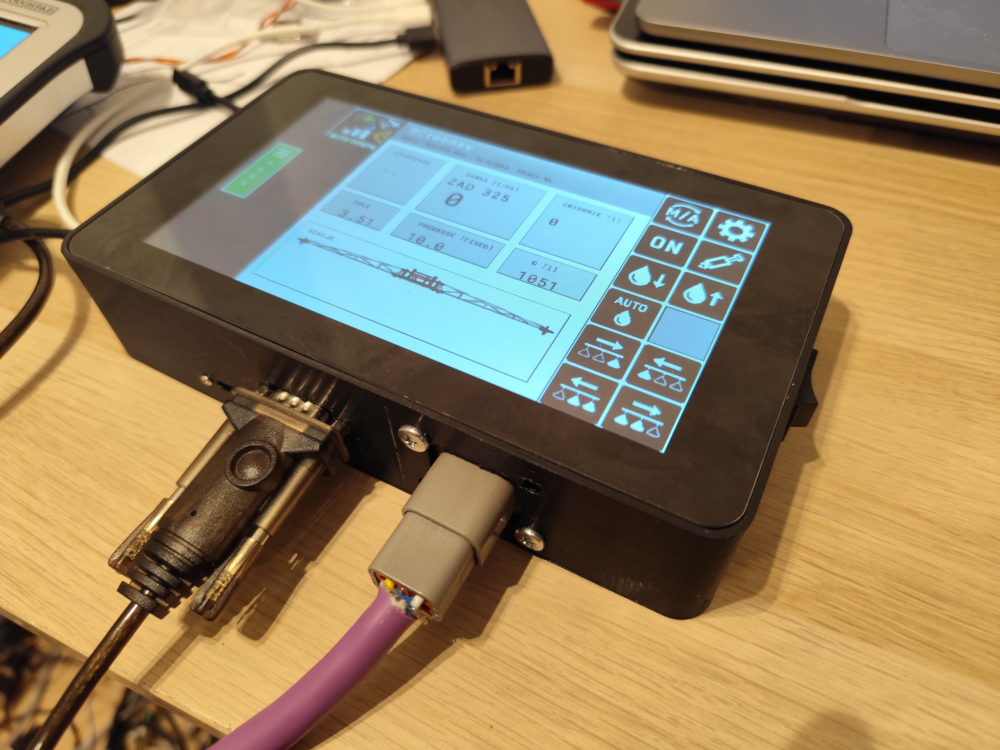

# espVT — ESP32-S3 ISOBUS Virtual Terminal

[Polski](README.md) | **English**

> **Status:** experimental, unofficial and not ISO 11783 certified. Do not use
> it as the sole control or safety device for agricultural machinery.

An ISOBUS/UT access terminal for the Waveshare ESP32-S3-Touch-LCD-7B board,
built on AgIsoStack++. The Guition JC8012P4A1C_I_W_Y board with an ESP32-P4 and a
10.1" display is supported experimentally.

The repository also contains firmware for a separate AUX-N button panel for the
ESP32U in the `auxn_buttons_esp32` directory.



## Goal

The application is intended to work as an ISO 11783-6 Virtual Terminal Server:

- receive ISOBUS data over CAN/TWAI,
- handle address claim through AgIsoStack++,
- accept and buffer IOP object pools from ECUs,
- AUX-N Type 2: detect input devices and send function assignments,
- render the active working set on the 1024x600 LCD,
- send touch/button events to the ECU as VT messages,
- store object pool versions in flash/NVS.

## Hardware

The ESP32-S3-Touch-LCD-7B board has:

- 7-inch RGB LCD, 1024x600,
- touch over I2C, IRQ on GPIO4,
- CAN/TWAI: TX GPIO20, RX GPIO19,
- I2C: SDA GPIO8, SCL GPIO9,
- a USB/CAN switch through the CH32V003 I/O controller at I2C `0x24`: EXIO5 must be set high for CAN.

Note: the USB port and CAN share the GPIO19/20 lines. Use the board's UART/USB
port for programming, or switch EXIO5 to USB mode as described in the Waveshare
documentation.

### Guition JC8012P4A1C_I_W_Y (ESP32-P4, experimental)

- 10.1" MIPI-DSI LCD, 800x1280 panel (JD9365, "new panel", SKU 10153001-V3),
  used in landscape as 1280x800; the PPA does the rotation in hardware,
- GSL3680 touch over I2C (SDA GPIO7, SCL GPIO8, RST GPIO22, INT GPIO21),
- backlight GPIO23, LCD reset GPIO27,
- no CAN transceiver on the board. Use an external transceiver with 5 V VCC
  and a 3.3 V VIO pin, e.g. TCAN1044AV-Q1 (TI) or TJA1051T/3 / TJA1462 (NXP);
  its bus pins should withstand a short to the 12/24 V supply. VCC 5 V comes
  from your own 12/24 V to 5 V converter (FPC3/FPC4 only provide 3.3 V), VIO
  3.3 V from VDDA on FPC3 pins 13/14, TXD/RXD on GPIO4/GPIO5 (FPC3 pins 8/7).
  FPC3 is a 14-pin 0.5 mm bottom-contact ZIF connector, matching Würth
  68711414522.

The terminal menu and the waiting screen (1024x600 layout) are scaled by 5/4 to
1280x750; the VT area uses the full 800-pixel height. The front camera is at the
top edge. Sound (ES8311) and GNSS are
not ported to this board yet.

## 3D-printed enclosure

The current enclosure model is in
`ESP32-S3-Touch-LCD-7B_V42_VESA_RAM_M5_SY8205_RS232_43MM_PETG.stl`.
It is designed for the variant with a VESA/RAM mount, M5 screws, an SY8205
power supply and an RS-232 connector; the intended material is PETG.

## Structure

- `main/board_pins.hpp` - hardware constants for the ESP32-S3-Touch-LCD-7B.
- `main/app_main.cpp` - application entry point.
- `main/board_support*` - I2C, IO expander and CAN mode initialization.
- `main/can_monitor.*` - TWAI startup through AgIsoStack++.
- `main/lcd_panel.*` - RGB565 driver for the 1024x600 panel with two framebuffers in PSRAM.
- `main/touch_gt911.*` - GT911 touch initialization and diagnostics.
- `main/isobus_terminal_server.*` - AgIsoStack++ VT server, including AUX-N objects.
- `main/vt_scene_renderer.*` - renderer for the basic VT objects and the touch area map.
- `main/lvgl_terminal_view.*` - diagnostic screen shown before a working set is loaded.
- `main/logo_image.*` - shows the scaled VTISOBUS/FarmNavi logo on the boot and waiting screens.
- `main/object_pool_store.*` - stores and loads object pools in flash.
- `tools/bmp_to_rgb565.py` - crops `logo.png` and converts it to RGB565 during the build.
- `main/gnss_um982.*` - optional NMEA input from a UM982 or an RS-232 port, plus NTRIP/RTCM for the RTK variant.

## AgIsoStack++

A modified version of AgIsoStack++ is included in
`third_party/AgIsoStack-plus-plus` to keep builds reproducible. The upstream base
commit and the scope of the local changes are recorded in
`third_party/AgIsoStack-plus-plus/ESPVT_UPSTREAM.md`. The library's original MIT
license is kept.

The adapter is enabled by default. Before connecting to a real bus, set your
assigned manufacturer code and a unique terminal number:

```sh
./make_espVT.sh menuconfig Waveshare7B_RS232
```

and set `ISOVT_MANUFACTURER_CODE` and `ISOVT_IDENTITY_NUMBER`. Each target has
its own configuration in `build_<target>/sdkconfig`, so set these values for every
target you use.

## Building

ESP-IDF 6.1 with ESP32-S3 and ESP32-P4 support is required. If `idf.py` is not available,
`make_espVT.sh` loads the environment from
`~/.espressif/tools/activate_idf_v6.1.sh`; point the `IDF_ACTIVATE` variable at a
different installation if needed.

The project uses `CONFIG_APP_NO_BLOBS=y` by default so that the binary Wi-Fi and
Bluetooth libraries are not linked. The terminal uses CAN/TWAI, I2C and SPIFFS,
so this keeps platform dependencies to what is needed.

```sh
./make_espVT.sh                                 # all targets
./make_espVT.sh Waveshare7B_RS232               # one target
./make_espVT.sh JC8012P4 force                  # rebuild from scratch
./make_espVT.sh flash Waveshare7B_RS232 /dev/ttyACM0  # flash and monitor
./make_espVT.sh clean                           # remove the build directories
```

| Target | Chip | Additional configuration |
|---|---|---|
| `Waveshare7B` | ESP32-S3 | `sdkconfig.defaults.Waveshare7B.esp32s3` |
| `Waveshare7B_RS232` | ESP32-S3 | + `sdkconfig.defaults.rs232` |
| `Waveshare7B_NTRIP` | ESP32-S3 | + `sdkconfig.defaults.ntrip` |
| `JC8012P4` | ESP32-P4 | `sdkconfig.defaults.JC8012P4.esp32p4` |

The configuration is layered: `sdkconfig.defaults` (shared),
`sdkconfig.defaults.<chip>` (chip settings), `sdkconfig.defaults.<board>.<chip>`
(board) and optional `sdkconfig.defaults.<feature>` files. Each target builds in
`build_<target>/` with its own `sdkconfig`. The old names `default`, `rs232` and
`ntrip` still work as aliases, and `p4` means `JC8012P4`.

## Single firmware file for releases

Every build creates a complete image containing the bootloader, partition table
and application in `delivery/`, e.g. `delivery/espVT-v0.1.0-Waveshare7B_RS232.bin` (the
version comes from `git describe`). Flash the image at address `0x0`:

```sh
esptool.py --chip esp32s3 --port PORT write_flash 0x0 espVT-v0.1.0-Waveshare7B_RS232.bin
```

Attach this single `Waveshare7B_RS232` file to the GitHub Release. The image is meant
for 16 MB flash; the firmware runs it in QIO mode at 120 MHz (the image header
uses DIO/80 MHz, as is usual for ESP-IDF, and the bootloader switches over).

The build is checked with ESP-IDF 6.1 for the ESP32-S3. The firmware initializes
the 1024x600 RGB panel with the Waveshare parameters, shows the boot logo and a
screen that waits for the machine's working set, and checks the GT911 touch
controller over I2C. Once an IOP is loaded, the renderer supports
DataMask/AlarmMask, Container, SoftKeyMask and Key, Button, Input Boolean/String/Number,
Output String/Number, Output Rectangle and Output Line. Touch sends button and
soft key activations, or sets the focus of an input field. An Input Boolean field
toggles its `ON/OFF` state locally and sends the new value to the ECU.

## VT area size

The terminal menu lets you choose a logical working area of `480x480` or `600x600`.
Both modes use the full 600-pixel height of the display:

- `480x480` is the default and is scaled to `600x600` on the LCD, which keeps
  pools designed for the standard 480-pixel area compatible,
- `600x600` is drawn 1:1 and is reported to the ECU in the VT Get Hardware response.

Changing the size deletes the stored object pools and requires a terminal
restart. An AgIsoStack++ ECU whose pool is designed for `480x480` should enable
scaling after calling `set_object_pool(...)`:

```cpp
virtualTerminalClient.set_object_pool_scaling(0, 480, 60);
```

Without ECU-side scaling, an old 480 pool may only fill part of the logical 600
area. 480 therefore remains the safe setting for unknown machines.

## GNSS variants

The `RTK` variant with a UM982 receives NMEA `GGA` and `RMC` over UART, shows the
fix quality on the waiting screen and forwards RTCM from NTRIP to the receiver.
The `Serial` variant receives the same NMEA data through a MAX3232 and an RS-232
port. Both variants provide a position-quality gate for future section
automation when the receiver reports a fresh RTK fix.

The `Waveshare7B` target has no external GNSS (`ISOVT_GNSS_SOURCE_NONE`), which
disables GPS input and the speed sent over ISOBUS. The `Waveshare7B_RS232` target
enables RS-232 (UART1, RX GPIO11, 57600 bit/s). The `Waveshare7B_NTRIP` target
enables the UM982 with NTRIP; set the Wi-Fi and NTRIP credentials with
`./make_espVT.sh menuconfig Waveshare7B_NTRIP` and do not publish
`build_Waveshare7B_NTRIP/sdkconfig`.

```sh
./make_espVT.sh Waveshare7B_RS232
./make_espVT.sh flash Waveshare7B_RS232 PORT
```

Default wiring: `GPIO11 <- RXD` on the TTL side of the MAX3232 converter, plus a
common ground. On this module the pin labelled `RXD` is the output for data
received from the DB9; its `TXD` is not an output to the ESP. In the variant with
sound the port is receive-only. Never connect RS-232 levels directly to the
ESP32. The navigation profile uses 57600 bit/s (8N1).

## VT sounds

The terminal supports the sound priorities of Alarm Mask objects and the Control
Audio Signal and Set Audio Volume commands. The board has no built-in amplifier.
The default module is the mono I2S amplifier `MAX98357A`: `BCLK=GPIO6`,
`LRC=GPIO12`, `DIN=GPIO13`, `VIN=5V`, common ground. Connect a 4 ohm speaker only
between the module's `SPK+` and `SPK-` terminals. Never connect either speaker
terminal to ground. GPIO12/13 are shared with the SD card, so the SD card is not
available in this variant. Pins and volume levels are configurable in `menuconfig`.

Before using section automation, select the minimum GNSS quality in
`menuconfig`. The default is `RTK FIX`; allow `RTK FLOAT` only after field
validation for the specific machine and acceptable overlap. Wiring and
configuration details are in `GNSS_NTRIP.md` (Polish).

## Next technical steps

1. Confirm that EXIO5 switches the board into CAN mode.
2. Change the default manufacturer code and terminal number before the first address claim.
3. Add the missing renderer objects: PictureGraphic, GraphicsContext, Line/Ellipse/Polygon,
   Input List, and full number and text editing.
4. Add an AUX-N assignment screen and test assignment with a real AUX controller.
5. Test with an ECU that sends a simple IOP, and only then with a real machine.

## References

- Waveshare ESP32-S3-Touch-LCD-7B: https://docs.waveshare.com/ESP32-S3-Touch-LCD-7B
- AgIsoStack++: https://agisostack.com
- AgIsoStack++ installation: https://agisostack-plus-plus.readthedocs.io/en/latest/Installation.html
- AgIsoStack++ VT API: https://agisostack-plus-plus.readthedocs.io/en/latest/api/virtual%20terminal/index.html

## Running on the board

The first-test sequence and the expected messages are described in `BRINGUP.md` (Polish).

## License

espVT is distributed under the GNU GPL version 3 or (at your option) any later
version, see `LICENSE`. Earlier espVT code was published under the MIT license;
its text and copyright notice are kept in `LICENSES/MIT-espVT.txt`. The change
follows from including the GSL3680 touch driver (`components/esp_lcd_touch_gsl3680`),
whose Silead algorithm is licensed GPL-2.0-or-later. AgIsoStack++ in
`third_party/` keeps its own MIT license, and ESP-IDF is Apache-2.0.
