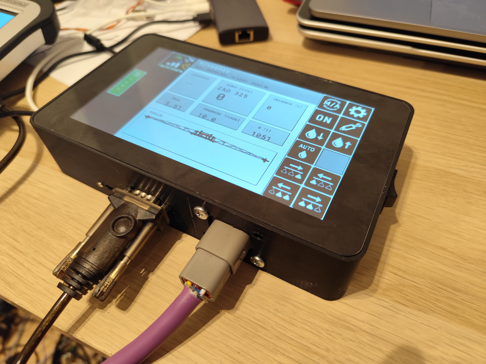

# espVT — ESP32-S3 ISOBUS Virtual Terminal

> **Status:** experimental, unofficial and not ISO 11783 certified. Do not use
> it as the sole control or safety device for agricultural machinery.

Projekt terminala dostepowego ISOBUS/UT na plytce Waveshare
ESP32-S3-Touch-LCD-7B z AgIsoStack++.

Repozytorium zawiera również firmware osobnego panelu przycisków AUX-N dla
ESP32U w katalogu `auxn_buttons_esp32`.



## Cel

Docelowo ta aplikacja ma dzialac jako Virtual Terminal Server ISO 11783-6:

- odbior danych ISOBUS po CAN/TWAI,
- obsluga address claim przez AgIsoStack++,
- przyjmowanie i buforowanie object pooli IOP od ECU,
- AUX-N Type 2: wykrywanie urzadzen wejscia i wysylanie przypisan funkcji,
- renderowanie aktualnego working setu na LCD 1024x600,
- wysylanie zdarzen dotyku/przyciskow jako komunikaty VT do ECU,
- zapis wersji object pooli w pamieci flash/NVS.

## Sprzet

Plytka ESP32-S3-Touch-LCD-7B ma:

- LCD RGB 7 cali, 1024x600,
- dotyk po I2C, IRQ na GPIO4,
- CAN/TWAI: TX GPIO20, RX GPIO19,
- I2C: SDA GPIO8, SCL GPIO9,
- przelacznik USB/CAN przez kontroler CH32V003 I/O na I2C `0x24`: EXIO5 musi byc ustawione wysoko dla CAN.

Uwaga: port USB i CAN wspoldziela linie GPIO19/20. Do programowania uzywaj portu
UART/USB plytki albo przelacz EXIO5 w tryb USB zgodnie z dokumentacja Waveshare.

## Obudowa do druku 3D

Aktualny model obudowy znajduje się w pliku
`ESP32-S3-Touch-LCD-7B_V42_VESA_RAM_M5_SY8205_RS232_43MM_PETG.stl`.
Model jest przygotowany dla wariantu z mocowaniem VESA/RAM, śrubami M5,
zasilaniem SY8205 i złączem RS-232; przewidziany materiał to PETG.

## Struktura

- `main/board_pins.hpp` - stale sprzetowe dla ESP32-S3-Touch-LCD-7B.
- `main/app_main.cpp` - punkt startowy aplikacji.
- `main/board_support.*` - inicjalizacja I2C, ekspandera IO i trybu CAN.
- `main/can_monitor.*` - uruchomienie TWAI przez AgIsoStack++.
- `main/lcd_panel.*` - sterownik RGB565 panelu 1024x600 z dwoma buforami w PSRAM.
- `main/touch_gt911.*` - inicjalizacja i diagnostyka dotyku GT911.
- `main/isobus_terminal_server.*` - serwer VT AgIsoStack++, w tym obiekty AUX-N.
- `main/vt_scene_renderer.*` - renderer podstawowych obiektow VT i mapa obszarow dotyku.
- `main/lvgl_terminal_view.*` - ekran diagnostyczny uruchamiany przed zaladowaniem working setu.
- `main/logo_image.*` - wyswietlanie zmniejszonego logo VTISOBUS/FarmNavi na ekranie startowym i oczekiwania.
- `main/object_pool_store.*` - zapis/odczyt object pooli w flash.
- `tools/bmp_to_rgb565.py` - automatyczne kadrowanie i konwersja `logo.png` do RGB565 podczas buildu.
- `main/gnss_um982.*` - opcjonalny odbior NMEA z UM982 albo portu RS-232 oraz NTRIP/RTCM dla wariantu RTK.

## AgIsoStack++

Zmodyfikowana wersja AgIsoStack++ jest dołączona w
`third_party/AgIsoStack-plus-plus`, aby kompilacja była powtarzalna. Informacja
o bazowym commicie upstream i zakresie lokalnych zmian znajduje się w pliku
`third_party/AgIsoStack-plus-plus/ESPVT_UPSTREAM.md`. Zachowana jest również
oryginalna licencja MIT biblioteki.

Adapter jest domyslnie wlaczony. Przed podlaczeniem do prawdziwej magistrali
ustaw przydzielony kod producenta oraz unikalny numer terminala:

```sh
idf.py menuconfig
```

i ustaw `ISOVT_MANUFACTURER_CODE` i `ISOVT_IDENTITY_NUMBER`.

## Budowanie

Wymagane jest ESP-IDF z obsluga ESP32-S3.

Projekt ma domyslnie `CONFIG_APP_NO_BLOBS=y`, aby nie linkowac binarnych
bibliotek Wi-Fi/Bluetooth. Terminal korzysta z CAN/TWAI, I2C i SPIFFS, wiec ta
konfiguracja ogranicza niepotrzebne zaleznosci platformy.

```sh
idf.py set-target esp32s3
idf.py build
idf.py flash monitor
```

## Jeden plik firmware do release

Po zbudowaniu wariantu RS-232 można utworzyć kompletny obraz zawierający
bootloader, tablicę partycji i aplikację:

```sh
cmake --build build-rs232 --target merge-bin
```

Powstanie plik `build-rs232/merged-binary.bin`, gotowy do wgrania od adresu
`0x0`:

```sh
esptool.py --chip esp32s3 --port PORT write_flash 0x0 merged-binary.bin
```

Do GitHub Release należy dołączyć ten jeden plik, nazwany na przykład
`espVT-v0.1.0-RS232.bin`. Obraz jest przeznaczony dla pamięci flash 16 MB,
trybu DIO i częstotliwości 80 MHz.

Build zostal zweryfikowany na ESP-IDF 5.5 dla ESP32-S3. Firmware inicjalizuje
panel RGB 1024x600 zgodnie z parametrami Waveshare, pokazuje logo startowe
i ekran oczekiwania na working set maszyny,
i sprawdza kontroler dotyku GT911 po I2C. Po zaladowaniu IOP renderer obsluguje
DataMask/AlarmMask, Container, SoftKeyMask i Key, Button, Input Boolean/String/Number,
Output String/Number, Output Rectangle oraz Output Line. Dotyk wysyla aktywacje przyciskow i klawiszy
programowych albo ustawia fokus pola wejscia.
Pole Input Boolean przelacza lokalnie stan `ON/OFF` i wysyla do ECU nowa wartosc.

## Rozmiar obszaru VT

Menu terminala pozwala wybrac logiczny obszar roboczy `480x480` albo `600x600`.
Oba tryby wykorzystuja pelna wysokosc 600 pikseli wyswietlacza:

- `480x480` jest domyslny i jest skalowany na LCD do `600x600`, co zapewnia
  zgodnosc z pulami zaprojektowanymi na standardowy obszar 480 pikseli,
- `600x600` jest rysowany 1:1 i jest zglaszany ECU w odpowiedzi VT Get Hardware.

Zmiana rozmiaru usuwa zapisane pule obiektow i wymaga ponownego uruchomienia
terminala. ECU z AgIsoStack++, ktore ma pule zaprojektowana dla `480x480`, powinno
po wywolaniu `set_object_pool(...)` wlaczyc skalowanie:

```cpp
virtualTerminalClient.set_object_pool_scaling(0, 480, 60);
```

Bez skalowania po stronie ECU stara pula 480 moze zajac tylko czesc logicznego
obszaru 600. Rozmiar 480 pozostaje wiec bezpiecznym ustawieniem dla nieznanych maszyn.

## Warianty GNSS

Wariant `RTK` z UM982 odbiera NMEA `GGA` i `RMC` po UART, pokazuje jakosc fixu na
ekranie oczekiwania i przekazuje RTCM z NTRIP do odbiornika. Wariant `Serial` odbiera
te same dane NMEA przez MAX3232 i port RS-232. Oba warianty udostepniaja bramke jakosci
pozycji dla przyszlej automatyki sekcji, jezeli odbiornik raportuje swiezy RTK.

Biezacy `sdkconfig` ma wlaczony RS-232 (UART1, RX GPIO11, 57600 bit/s), tak samo
jak `sdkconfig.rs232`. Zachowaj te ustawienia przy zwyklym `idf.py build flash`:
wybor `ISOVT_GNSS_SOURCE_NONE` wylacza odbior GPS i predkosc wysylana po ISOBUS.
Osobny wariant RS-232 mozna zbudowac ponizszym poleceniem; przy wgrywaniu nalezy
uzyc tego samego katalogu i konfiguracji (zastap `build` przez `-p PORT flash`):

```sh
idf.py -B build-rs232 \
  -D SDKCONFIG="$PWD/sdkconfig.rs232" \
  -D SDKCONFIG_DEFAULTS="sdkconfig.defaults;sdkconfig.rs232.defaults" build
```

Domyslne polaczenie: `GPIO11 <- RXD` po stronie TTL uzytego konwertera MAX3232 oraz
wspolna masa. W tym module pin opisany `RXD` jest wyjsciem danych odebranych z DB9;
jego `TXD` nie jest wyjsciem do ESP. W wariancie z dzwiekiem port jest tylko
odbiorczy. Nie wolno laczyc poziomow RS-232 bezposrednio z ESP32. Profil nawigacyjny
uzywa 57600 bit/s (8N1).

## Dzwieki VT

Terminal obsluguje priorytety dzwieku obiektow Alarm Mask oraz komendy Control Audio
Signal i Set Audio Volume. Plytka nie ma wbudowanego wzmacniacza. Domyslnym modulem
jest monofoniczny wzmacniacz I2S `MAX98357A`: `BCLK=GPIO6`, `LRC=GPIO12`,
`DIN=GPIO13`, `VIN=5V`, wspolna masa. Glosnik 4 ohm podlacza sie wylacznie pomiedzy
zaciski `SPK+` i `SPK-` modulu. Nie wolno laczyc zadnego zacisku glosnika z masa.
GPIO12/13 sa wspoldzielone z karta SD, dlatego karta SD jest w tym wariancie
niedostepna. Piny i poziomy glosnosci sa konfigurowalne w `menuconfig`.

Przed automatyka sekcji wybierz w `menuconfig` minimalna jakosc GNSS. Domyslnie jest
to `RTK FIX`; `RTK FLOAT` mozna dopuscic dopiero po walidacji w polu dla konkretnej
maszyny i dopuszczalnego nakladania. Szczegoly podlaczenia i konfiguracji sa w
`GNSS_NTRIP.md`.

## Kolejne kroki techniczne

1. Potwierdzic, ze EXIO5 przelacza plytke w tryb CAN.
2. Zmienic domyslny kod producenta i numer terminala przed pierwszym address claim.
3. Dodac brakujace obiekty renderera: PictureGraphic, GraphicsContext, Line/Ellipse/Polygon,
   Input List oraz pelna edycje liczb i tekstu.
4. Dodac ekran przypisan AUX-N i przetestowac przypisanie z prawdziwym kontrolerem AUX.
5. Przetestowac z ECU wysylajacym prosty IOP, a dopiero potem z prawdziwa maszyna.

## Zrodla projektowe

- Waveshare ESP32-S3-Touch-LCD-7B: https://docs.waveshare.com/ESP32-S3-Touch-LCD-7B
- AgIsoStack++: https://agisostack.com
- AgIsoStack++ installation: https://agisostack-plus-plus.readthedocs.io/en/latest/Installation.html
- AgIsoStack++ VT API: https://agisostack-plus-plus.readthedocs.io/en/latest/api/virtual%20terminal/index.html

## Uruchomienie na plytce

Kolejnosc pierwszego testu i oczekiwane komunikaty sa opisane w `BRINGUP.md`.
