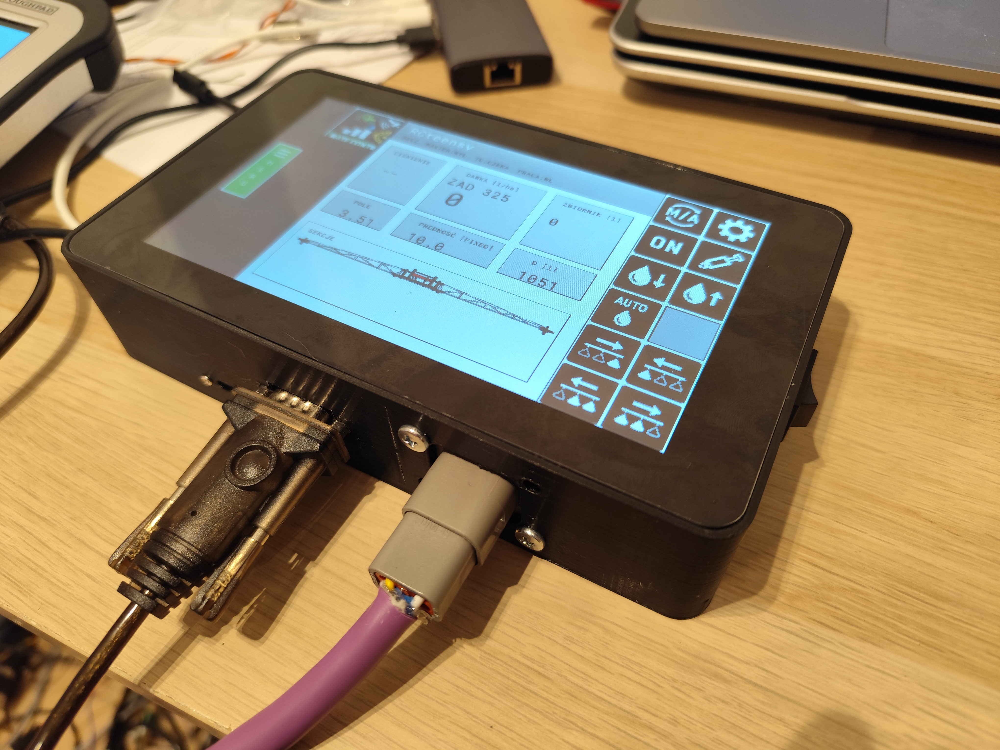

# espVT — ESP32-S3 ISOBUS Virtual Terminal

**Polski** | [English](README.en.md)

> **Status:** experimental, unofficial and not ISO 11783 certified. Do not use
> it as the sole control or safety device for agricultural machinery.

Projekt terminala dostepowego ISOBUS/UT na plytce Waveshare
ESP32-S3-Touch-LCD-7B z AgIsoStack++. Eksperymentalnie obslugiwana jest tez
plytka Guition JC8012P4A1C_I_W_Y z ESP32-P4 i ekranem 10,1 cala.

Repozytorium zawiera również firmware osobnego panelu przycisków AUX-N dla
ESP32U w katalogu `auxn_buttons_esp32`.



## Cel

Docelowo ta aplikacja ma dzialac jako Virtual Terminal Server ISO 11783-6:

- odbior danych ISOBUS po CAN/TWAI,
- obsluga address claim przez AgIsoStack++,
- przyjmowanie i buforowanie object pooli IOP od ECU,
- AUX-N Type 2: wykrywanie urzadzen wejscia i wysylanie przypisan funkcji,
- renderowanie aktualnego working setu na LCD 1024x600,
- wysylanie zdarzen dotyku/przyciskow jako komunikaty VT do ECU,
- zapis wersji object pooli w pamieci flash/NVS.

## Sprzet

Plytka ESP32-S3-Touch-LCD-7B ma:

- LCD RGB 7 cali, 1024x600,
- dotyk po I2C, IRQ na GPIO4,
- CAN/TWAI: TX GPIO20, RX GPIO19,
- I2C: SDA GPIO8, SCL GPIO9,
- przelacznik USB/CAN przez kontroler CH32V003 I/O na I2C `0x24`: EXIO5 musi byc ustawione wysoko dla CAN.

Uwaga: port USB i CAN wspoldziela linie GPIO19/20. Do programowania uzywaj portu
UART/USB plytki albo przelacz EXIO5 w tryb USB zgodnie z dokumentacja Waveshare.

### Guition JC8012P4A1C_I_W_Y (ESP32-P4, eksperymentalnie)

- LCD MIPI-DSI 10,1 cala, panel 800x1280 (JD9365, "new panel", SKU 10153001-V3),
  uzywany poziomo jako 1280x800; obrot wykonuje sprzetowo PPA,
- dotyk GSL3680 po I2C (SDA GPIO7, SCL GPIO8, RST GPIO22, INT GPIO21),
- podswietlenie GPIO23, reset LCD GPIO27,
- plytka nie ma transceivera CAN. Potrzebny jest zewnetrzny transceiver z zasilaniem
  VCC 5 V i pinem VIO 3,3 V, np. TCAN1044AV-Q1 (TI) albo TJA1051T/3 lub TJA1462
  (NXP); piny magistrali powinny wytrzymac zwarcie do zasilania 12/24 V.
  VCC 5 V pochodzi z wlasnej przetwornicy 12/24 V -> 5 V (FPC3/FPC4 daja tylko
  3,3 V), VIO 3,3 V z VDDA na FPC3 (piny 13/14), TXD/RXD na GPIO4/GPIO5
  (FPC3 piny 8/7). FPC3 to 14-pinowe zlacze ZIF 0,5 mm (styki dolne), pasuje
  Wurth 68711414522.

Menu terminala i ekran oczekiwania (uklad 1024x600) sa skalowane 5/4 do 1280x750;
obszar VT wykorzystuje pelna wysokosc 800 pikseli. Kamera jest u gory ekranu. Dzwiek (ES8311)
i GNSS nie sa jeszcze przeniesione na te plytke.

## Obudowa do druku 3D

Aktualny model obudowy znajduje się w pliku
`ESP32-S3-Touch-LCD-7B_V42_VESA_RAM_M5_SY8205_RS232_43MM_PETG.stl`.
Model jest przygotowany dla wariantu z mocowaniem VESA/RAM, śrubami M5,
zasilaniem SY8205 i złączem RS-232; przewidziany materiał to PETG.

## Struktura

- `main/board_pins.hpp` - stale sprzetowe dla ESP32-S3-Touch-LCD-7B.
- `main/app_main.cpp` - punkt startowy aplikacji.
- `main/board_support*` - inicjalizacja I2C, ekspandera IO i trybu CAN.
- `main/can_monitor.*` - uruchomienie TWAI przez AgIsoStack++.
- `main/lcd_panel.*` - sterownik RGB565 panelu 1024x600 z dwoma buforami w PSRAM.
- `main/touch_gt911.*` - inicjalizacja i diagnostyka dotyku GT911.
- `main/isobus_terminal_server.*` - serwer VT AgIsoStack++, w tym obiekty AUX-N.
- `main/vt_scene_renderer.*` - renderer podstawowych obiektow VT i mapa obszarow dotyku.
- `main/lvgl_terminal_view.*` - ekran diagnostyczny uruchamiany przed zaladowaniem working setu.
- `main/logo_image.*` - wyswietlanie zmniejszonego logo VTISOBUS/FarmNavi na ekranie startowym i oczekiwania.
- `main/object_pool_store.*` - zapis/odczyt object pooli w flash.
- `tools/bmp_to_rgb565.py` - automatyczne kadrowanie i konwersja `logo.png` do RGB565 podczas buildu.
- `main/gnss_um982.*` - opcjonalny odbior NMEA z UM982 albo portu RS-232 oraz NTRIP/RTCM dla wariantu RTK.

## AgIsoStack++

Zmodyfikowana wersja AgIsoStack++ jest dołączona w
`third_party/AgIsoStack-plus-plus`, aby kompilacja była powtarzalna. Informacja
o bazowym commicie upstream i zakresie lokalnych zmian znajduje się w pliku
`third_party/AgIsoStack-plus-plus/ESPVT_UPSTREAM.md`. Zachowana jest również
oryginalna licencja MIT biblioteki.

Adapter jest domyslnie wlaczony. Przed podlaczeniem do prawdziwej magistrali
ustaw przydzielony kod producenta oraz unikalny numer terminala:

```sh
./make_espVT.sh menuconfig Waveshare7B_RS232
```

i ustaw `ISOVT_MANUFACTURER_CODE` i `ISOVT_IDENTITY_NUMBER`. Kazdy target ma
wlasna konfiguracje w `build_<target>/sdkconfig`, wiec ustawienia trzeba wprowadzic
dla kazdego uzywanego targetu.

## Budowanie

Wymagane jest ESP-IDF 6.1 z obsluga ESP32-S3 i ESP32-P4. Skrypt `make_espVT.sh` sam laduje
srodowisko z `~/.espressif/tools/activate_idf_v6.1.sh`, jezeli `idf.py` nie jest
dostepne; inna instalacje mozna wskazac zmienna `IDF_ACTIVATE`.

Projekt ma domyslnie `CONFIG_APP_NO_BLOBS=y`, aby nie linkowac binarnych
bibliotek Wi-Fi/Bluetooth. Terminal korzysta z CAN/TWAI, I2C i SPIFFS, wiec ta
konfiguracja ogranicza niepotrzebne zaleznosci platformy.

```sh
./make_espVT.sh                                 # wszystkie targety
./make_espVT.sh Waveshare7B_RS232               # jeden target
./make_espVT.sh JC8012P4 force                  # przebudowanie od zera
./make_espVT.sh flash Waveshare7B_RS232 /dev/ttyACM0  # wgranie i monitor
./make_espVT.sh clean                           # usuniecie katalogow build
```

| Target | Chip | Dodatkowa konfiguracja |
|---|---|---|
| `Waveshare7B` | ESP32-S3 | `sdkconfig.defaults.Waveshare7B.esp32s3` |
| `Waveshare7B_RS232` | ESP32-S3 | + `sdkconfig.defaults.rs232` |
| `Waveshare7B_NTRIP` | ESP32-S3 | + `sdkconfig.defaults.ntrip` |
| `JC8012P4` | ESP32-P4 | `sdkconfig.defaults.JC8012P4.esp32p4` |

Konfiguracja jest warstwowa: `sdkconfig.defaults` (wspolne), `sdkconfig.defaults.<chip>`
(ustawienia ukladu), `sdkconfig.defaults.<plytka>.<chip>` (plytka) oraz opcjonalne
`sdkconfig.defaults.<funkcja>`. Kazdy target buduje sie w `build_<target>/` z wlasnym
`sdkconfig`. Stare nazwy `default`, `rs232` i `ntrip` dzialaja jako aliasy, a `p4`
oznacza `JC8012P4`.

## Jeden plik firmware do release

Kazdy build tworzy kompletny obraz zawierajacy bootloader, tablice partycji
i aplikacje, w katalogu `delivery/`, np. `delivery/espVT-v0.1.0-Waveshare7B_RS232.bin`
(wersja pochodzi z `git describe`). Obraz wgrywa sie od adresu `0x0`:

```sh
esptool.py --chip esp32s3 --port PORT write_flash 0x0 espVT-v0.1.0-Waveshare7B_RS232.bin
```

Do GitHub Release należy dołączyć ten jeden plik targetu `Waveshare7B_RS232`. Obraz jest
przeznaczony dla pamięci flash 16 MB; firmware pracuje z nią w trybie QIO
przy 120 MHz (nagłówek obrazu ma, jak zwykle w ESP-IDF, DIO/80 MHz, a bootloader
przełącza tryb).

Build panelu AUX-N automatycznie tworzy drugi kompletny obraz
`releases/espVT-AUX-N-ESP32U.bin`. Jest on przeznaczony dla klasycznego ESP32U
z pamięcią 4 MB i również wgrywa się go od adresu `0x0`.

Build jest sprawdzany na ESP-IDF 6.1 dla ESP32-S3. Firmware inicjalizuje
panel RGB 1024x600 zgodnie z parametrami Waveshare, pokazuje logo startowe
i ekran oczekiwania na working set maszyny,
i sprawdza kontroler dotyku GT911 po I2C. Po zaladowaniu IOP renderer obsluguje
DataMask/AlarmMask, Container, SoftKeyMask i Key, Button, Input Boolean/String/Number,
Output String/Number, Output Rectangle oraz Output Line. Dotyk wysyla aktywacje przyciskow i klawiszy
programowych albo ustawia fokus pola wejscia.
Pole Input Boolean przelacza lokalnie stan `ON/OFF` i wysyla do ECU nowa wartosc.

## Rozmiar obszaru VT

Menu terminala pozwala wybrac logiczny obszar roboczy `480x480` albo `600x600`.
Oba tryby wykorzystuja pelna wysokosc 600 pikseli wyswietlacza:

- `480x480` jest domyslny i jest skalowany na LCD do `600x600`, co zapewnia
  zgodnosc z pulami zaprojektowanymi na standardowy obszar 480 pikseli,
- `600x600` jest rysowany 1:1 i jest zglaszany ECU w odpowiedzi VT Get Hardware.

Zmiana rozmiaru usuwa zapisane pule obiektow i wymaga ponownego uruchomienia
terminala. ECU z AgIsoStack++, ktore ma pule zaprojektowana dla `480x480`, powinno
po wywolaniu `set_object_pool(...)` wlaczyc skalowanie:

```cpp
virtualTerminalClient.set_object_pool_scaling(0, 480, 60);
```

Bez skalowania po stronie ECU stara pula 480 moze zajac tylko czesc logicznego
obszaru 600. Rozmiar 480 pozostaje wiec bezpiecznym ustawieniem dla nieznanych maszyn.

## Warianty GNSS

Wariant `RTK` z UM982 odbiera NMEA `GGA` i `RMC` po UART, pokazuje jakosc fixu na
ekranie oczekiwania i przekazuje RTCM z NTRIP do odbiornika. Wariant `Serial` odbiera
te same dane NMEA przez MAX3232 i port RS-232. Oba warianty udostepniaja bramke jakosci
pozycji dla przyszlej automatyki sekcji, jezeli odbiornik raportuje swiezy RTK.

Target `Waveshare7B` nie ma zewnetrznego GNSS (`ISOVT_GNSS_SOURCE_NONE`), co wylacza
odbior GPS i predkosc wysylana po ISOBUS. Target `Waveshare7B_RS232` wlacza RS-232
(UART1, RX GPIO11, 57600 bit/s). Target `Waveshare7B_NTRIP` wlacza UM982 z NTRIP;
dane Wi-Fi i NTRIP ustaw przez `./make_espVT.sh menuconfig Waveshare7B_NTRIP`
i nie publikuj pliku `build_Waveshare7B_NTRIP/sdkconfig`.

```sh
./make_espVT.sh Waveshare7B_RS232
./make_espVT.sh flash Waveshare7B_RS232 PORT
```

Domyslne polaczenie: `GPIO11 <- RXD` po stronie TTL uzytego konwertera MAX3232 oraz
wspolna masa. W tym module pin opisany `RXD` jest wyjsciem danych odebranych z DB9;
jego `TXD` nie jest wyjsciem do ESP. W wariancie z dzwiekiem port jest tylko
odbiorczy. Nie wolno laczyc poziomow RS-232 bezposrednio z ESP32. Profil nawigacyjny
uzywa 57600 bit/s (8N1).

## Dzwieki VT

Terminal obsluguje priorytety dzwieku obiektow Alarm Mask oraz komendy Control Audio
Signal i Set Audio Volume. Plytka nie ma wbudowanego wzmacniacza. Domyslnym modulem
jest monofoniczny wzmacniacz I2S `MAX98357A`: `BCLK=GPIO6`, `LRC=GPIO12`,
`DIN=GPIO13`, `VIN=5V`, wspolna masa. Glosnik 4 ohm podlacza sie wylacznie pomiedzy
zaciski `SPK+` i `SPK-` modulu. Nie wolno laczyc zadnego zacisku glosnika z masa.
GPIO12/13 sa wspoldzielone z karta SD, dlatego karta SD jest w tym wariancie
niedostepna. Piny i poziomy glosnosci sa konfigurowalne w `menuconfig`.

Przed automatyka sekcji wybierz w `menuconfig` minimalna jakosc GNSS. Domyslnie jest
to `RTK FIX`; `RTK FLOAT` mozna dopuscic dopiero po walidacji w polu dla konkretnej
maszyny i dopuszczalnego nakladania. Szczegoly podlaczenia i konfiguracji sa w
`GNSS_NTRIP.md`.

## Kolejne kroki techniczne

1. Potwierdzic, ze EXIO5 przelacza plytke w tryb CAN.
2. Zmienic domyslny kod producenta i numer terminala przed pierwszym address claim.
3. Dodac brakujace obiekty renderera: PictureGraphic, GraphicsContext, Line/Ellipse/Polygon,
   Input List oraz pelna edycje liczb i tekstu.
4. Przetestowac ekran przypisan AUX-N z prawdziwym kontrolerem AUX i ECU maszyny.
5. Przetestowac z ECU wysylajacym prosty IOP, a dopiero potem z prawdziwa maszyna.

## Zrodla projektowe

- Waveshare ESP32-S3-Touch-LCD-7B: https://docs.waveshare.com/ESP32-S3-Touch-LCD-7B
- AgIsoStack++: https://agisostack.com
- AgIsoStack++ installation: https://agisostack-plus-plus.readthedocs.io/en/latest/Installation.html
- AgIsoStack++ VT API: https://agisostack-plus-plus.readthedocs.io/en/latest/api/virtual%20terminal/index.html

## Uruchomienie na plytce

Kolejnosc pierwszego testu i oczekiwane komunikaty sa opisane w `BRINGUP.md`.

## Licencja

espVT jest udostepniany na licencji GNU GPL w wersji 3 lub (do wyboru) dowolnej
pozniejszej, patrz `LICENSE`. Wczesniejszy kod espVT byl publikowany na licencji
MIT; jej tekst i nota autorska sa zachowane w `LICENSES/MIT-espVT.txt`.
Zmiana wynika z wlaczenia sterownika dotyku GSL3680 (`components/esp_lcd_touch_gsl3680`),
ktorego algorytm Silead jest objety licencja GPL-2.0-or-later. AgIsoStack++
w `third_party/` zachowuje wlasna licencje MIT, a ESP-IDF licencje Apache-2.0.
